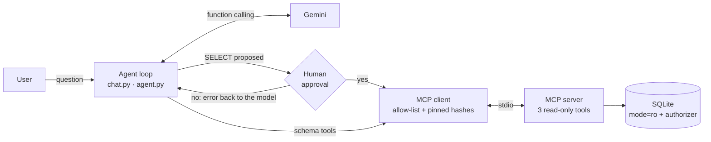

# nl-sql-agent


Ask questions in Italian about a healthcare database and get answers backed by SQL. The database is exposed through a **read-only MCP server**, and **every query waits for human approval** before it runs.

> All data is **synthetic** (Synthea), not real patients. See [Data](#data).

## Problem

Clinical and operational analysts often need numbers from a database but do not write SQL. An LLM can write the query, but in a healthcare setting it must not be able to change data, read what it should not read, or run a query nobody has checked. This project is a small, testable answer to that: what an NL→SQL assistant looks like when safety is designed into the architecture rather than asked for in the prompt.

## Architecture



1. The agent explores the schema with `list_tables` and `describe_table`, then proposes one `SELECT` through `run_select` (max 6 steps per question).
2. The SQL is shown to the user; only an explicit `s` runs it. A rejection goes back to the model as an error, and the query never reaches the server.
3. `/grafico` saves a bar chart of the last result. The chart is built by code from the returned rows, not by the model.

### Security layers

| Layer | What it blocks | Tested by |
|---|---|---|
| Data minimisation | Names, addresses, SSN, income and ethnicity are never loaded | schema in `schema.py` |
| SQLite `mode=ro` | Any write on this connection | `test_connection_is_read_only_even_without_the_authorizer` |
| SQLite authorizer (default deny) | Tables, functions and operations outside an allow-list | `test_dangerous_queries_are_refused` |
| Limits | More than 200 rows, 3 s, 4,000 characters | `test_slow_query_is_stopped`, `test_rows_are_truncated` |
| Client tool policy | Unknown tools and changed tool definitions (tool poisoning, rug pull) via SHA-256 pins | `test_poisoned_description_is_detected` |
| Human approval | Any query the user has not read | `test_rejected_query_never_reaches_the_server` |

Design choices are explained in [DECISIONS.md](DECISIONS.md).

## Results

Eval on 25 hand-written questions (`eval/questions.json`), model `gemini-3.5-flash-lite`, queries approved automatically so that the score measures the model alone. Two runs with the same configuration: run 2 in `eval/results_v0.json`, run 1 in `eval/results_v0_run1.json`.

| Metric | Run 2 | 95% Wilson CI | Run 1 |
|---|---|---|---|
| Execution accuracy (20 answerable questions): the result of the agent's last query matches a gold query | `20/20` | `0.84-1.00` | 20/20 |
| Abstention (5 unanswerable questions): no query proposed | `0/5` | `0.00-0.43` | 0/5 |
| Median model calls per question | `4` | | 4 |
| Median tokens per question (input / output incl. thinking) | `2184 / 159` | | not recorded |
| Median time per question | `7.7 s` | | 3.4 s |

**Execution:** no errors on the 20 answerable questions in run 1.

**Abstention:** in run 1 the agent proposed a query on all 5 unanswerable questions. Read by hand (post hoc, not a pre-registered metric), no answer invented data:
- 2 answered that the data is not available, after an exploratory query (one tried `PRAGMA`, refused by the server; one read 5 full patient rows);
- 3 answered a nearby question while saying so: patient ID instead of name, lifetime healthcare expenses instead of income, county instead of address.

Likely cause: the system prompt asks for every number to come from `run_select` and for the query used, which pushes the model to always run one. A prompt fix will be measured against this baseline on the same 25 questions.

Reproduce: `uv run python eval/run_eval.py`, then `uv run python eval/report.py`.

## Limits

- Small eval: 25 questions, two runs, one model. Intervals are wide; this is a smoke test, not a benchmark.
- Execution accuracy checks the query result, not the text of the answer: a correct query with a wrong number in the text counts as correct. Answer checking comes next.
- Unanswerable questions are scored only on the action (no query proposed), not on the wording of the answer.
- Read-only does not mean no leakage: what the model reads can end up in its answer. Row contents are untrusted text and prompt injection through data is not yet tested.
- The pins prove that tool definitions did not change after review, not that the reviewed version was safe.
- Single-user terminal app; SQLite only.
- The agent does not yet abstain: on unanswerable questions it runs exploratory or proxy queries. With real data this would mean unnecessary reads of patient records.

## Costs

- Gemini free tier: **0 €**. On the free tier Google may use prompts to improve its products, acceptable here only because the data is synthetic. Real patient data would need a paid tier with a data-processing agreement, or a local model.
- Paid tier estimate: `2184` input and `159` output tokens per question at `0.30` / `2.50` USD per 1M tokens ≈ `0.001` USD per question. Check current prices before quoting.

## Data

[Synthea](https://github.com/synthetichealth/synthea) sample data (CSV, 111 patients). Synthea describes its synthetic data as public domain and states it contains no PII or PHI. Download it from `synthetichealth/synthea-sample-data` (`downloads/latest/synthea_sample_data_csv_latest.zip`) and extract it into `data/raw/`. The data is not included in this repository.

## Setup

Requires [uv](https://docs.astral.sh/uv/) and a Gemini API key.

```bash
uv sync
cp .env.example .env            # then put your key in .env
uv run python -m nl_sql_agent.build_db
uv run python chat.py
```

Tests run without network, key or data: `uv run pytest -q`.

## License

MIT